# Final Project Report: Agentic AI for the Client Advisory Process

Onboarding, Risk Profiling, Recommendation, Compliance Check and Review · Advanced AI for Business Automation – Formative Assessment Project

[Team members] · 26 October 2026

## 1. Executive summary

We built a working multi-agent AI prototype that runs the full retail investment-advisory process, from client onboarding to an advisor-approved PDF report. All 16 synthetic test scenarios behaved as designed. Estimated processing time fell from 90 to about 10 minutes per case against an assumed manual baseline.

- **Architecture:** a LangGraph orchestrator routes each case between five specialist agents: Onboarding, Risk Profiling, Financial Analysis, Recommendation and Compliance. It pauses, re-plans or escalates based on their outputs.
- **AI and rules:** a local open-source LLM (Llama 3.2 3B via Ollama) reads free-text client notes and writes explanations and advisor briefings. Every score, allocation and compliance result is deterministic Python that the LLM cannot change.
- **Human oversight:** the advisor approves, modifies or rejects each case. Approval is blocked while any mandatory check fails.
- **Evidence:** 16 scenarios (8 exceptions) and 45 automated tests pass. Every agent action, tool call, LLM call and decision is in a SQLite audit trail.

All data is synthetic. The prototype executes no transactions and gives no real financial advice.

## 2. Problem and process

Manual client advisory is slow because one analyst moves each case by hand through eight steps, and every compliance failure or advisor rejection restarts part of the work. The main pain points are repetitive data handling, manual calculations, missing information found late, rework loops after rule failures, and decision evidence spread across notes and spreadsheets.

| | As-Is (manual) | To-Be (agentic) |
| --- | --- | --- |
| Who moves the case | Analyst, by hand | Orchestrator Agent, from case state |
| Missing or inconsistent data | Often found at compliance or review | Caught at intake; workflow paused |
| Risk score and calculations | Spreadsheets | Fixed Python formula, identical every time |
| Compliance failure | Email hand-off, about a day per cycle | Automatic re-plan in seconds, or escalation |
| Explanations | Written by the analyst | Drafted by the local LLM, figures from Python |
| Approval | Advisor sign-off | Advisor approve / modify / reject with enforced guards |
| Evidence | Notes, spreadsheets, email | One audit trail per case |

The project question: can a multi-agent AI system coordinate this process end to end, handle exceptions and keep a human accountable for the final decision? The rest of this report shows that it can, in a prototype on synthetic data.

## 3. Solution design

One orchestrator and five specialist agents share a single case state; the orchestrator decides every transition from what the agents write into it.

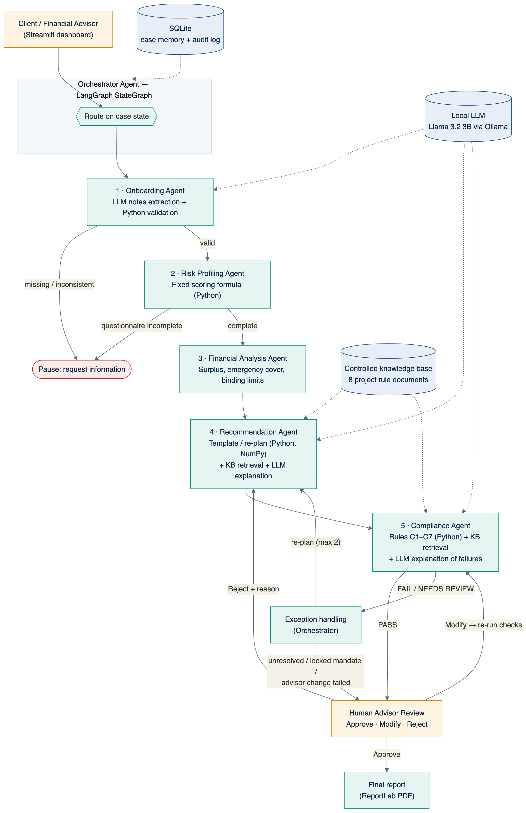

Figure 1. Architecture. Solid arrows are the case flow; dotted arrows are tool access.

### 3.1 Agents and their outputs

| Agent | Reads | Writes to case state | Orchestrator's next step |
| --- | --- | --- | --- |
| Onboarding | Client fields, free-text notes | valid flag, missing fields, inconsistencies, warnings | Pause if invalid, else risk profiling |
| Risk Profiling | Six questionnaire answers | score, category, drivers, cross-check warnings | Pause if incomplete, else financial analysis |
| Financial Analysis | Client finances, risk category | surplus, emergency cover, binding limits | Recommendation |
| Recommendation | Profile, limits, rules, feedback | allocation, rupee amounts, projections, explanation, citations | Compliance |
| Compliance | Allocation, limits, rules | PASS / FAIL / NEEDS REVIEW per rule C1–C7 | Human review on PASS, else exception handling |
| Orchestrator (exception node) | Compliance result, re-plan count, mandate flag | exception records, re-plan feedback or escalation | Re-plan (up to 2) or escalate to the advisor |

### 3.2 Orchestration logic

The orchestrator is a LangGraph state graph with conditional edges. Figure 2 is exported directly from the code, so it shows the real routing, not a drawing of intent.

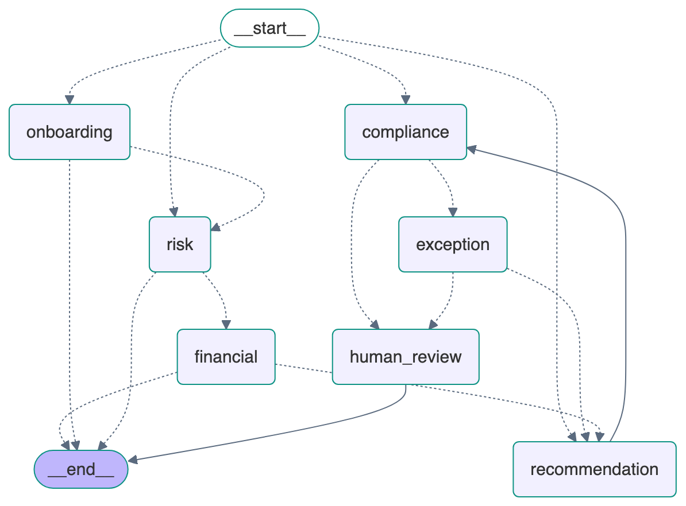

Figure 2. LangGraph graph. Dotted edges are conditional; compliance → exception → recommendation is the re-plan loop.

The exception node decides between re-planning and escalation:

1. Only NEEDS REVIEW items (for example, the knowledge source is down): escalate, because only a person can accept missing evidence.
2. The failing allocation was set by the advisor: escalate, because the agents do not overrule the advisor.
3. The client's mandate is locked: escalate with a compliant alternative prepared for the advisor.
4. Two re-plans already tried: escalate.
5. Otherwise: send the violated constraints back to the Recommendation Agent and re-plan.

### 3.3 Role of the LLM and guardrails

The LLM handles language; Python handles every number and decision.

| The LLM does | The LLM never does |
| --- | --- |
| Extract client fields from free-text notes | Calculate a risk score or an amount |
| Explain why an allocation fits the client | Choose or change an allocation |
| Explain failed rules in plain language | Decide PASS or FAIL |
| Write the advisor briefing | Approve a case |

If the LLM is unavailable or fails, each agent falls back to template text and the workflow finishes with identical results. Every LLM call is logged with the model name and response time.

## 4. Implementation

The prototype is about 3,000 lines of Python (including tests) in one repository, and it runs on a laptop with no paid services.

### 4.1 Technology stack

| Layer | Technology | Version |
| --- | --- | --- |
| Interface | Streamlit | 1.66 |
| Orchestration | LangGraph | 1.2 |
| Language model | Llama 3.2 3B via Ollama (local) | Ollama 0.40 |
| Calculations | Python, Pandas, NumPy | 3.12, 3.1, 2.5 |
| Memory and audit | SQLite | built into Python |
| Charts and report | Plotly, ReportLab | 7.1, 5.1 |
| Tests | pytest | 9.1 |

### 4.2 Code modules

| Module | Responsibility |
| --- | --- |
| app.py | Eight-page Streamlit interface and advisor actions |
| advisory/orchestrator.py | LangGraph graph, routing, exception handling, approve / modify / reject / what-if |
| advisory/agents.py | The five specialist agents |
| advisory/rules.py | Scoring formula, templates, limits, constraint fitting (single source of every threshold) |
| advisory/knowledge_base.py | Eight controlled rule documents and keyword retriever |
| advisory/llm.py | Local LLM client with fallback and output clean-up |
| advisory/db.py | SQLite case memory and audit log |
| advisory/scenarios.py | 16 synthetic scenarios |
| advisory/report.py, kpi.py | PDF report and KPI computation |

### 4.3 Risk-scoring method

Six questions are each scored 1 (most cautious) to 5 (most risk-seeking): loss tolerance, reaction to a 10–20% fall, horizon, experience, short-term liquidity need, and protection versus growth.

Risk score = a1 + a2 + a3 + a4 + a5 + a6, where each answer a is 1 to 5, so the score runs from 6 to 30.

Conservative 6–14, Moderate 15–22, Aggressive 23–30. The agent also flags answers that contradict onboarding data, such as a questionnaire horizon that differs from the stated horizon.

### 4.4 Allocation templates and compliance rules

Templates (debt / equity / gold): Conservative 70/20/10, Moderate 40/50/10, Aggressive 20/70/10. These are illustrative project assumptions.

| Rule | Check | Limit | Type |
| --- | --- | --- | --- |
| C1 | Information completeness | All fields and 6 answers present | Mandatory |
| C2 | Risk-profile alignment | Equity ≤ 30% / 60% / 80% by category | Mandatory |
| C3 | Horizon suitability | Equity ≤ 30% (<3 yrs), 60% (3–7 yrs), 80% (>7 yrs) | Mandatory |
| C4 | Liquidity requirement | Debt ≥ 15% / 30% / 50% for low / medium / high need | Mandatory |
| C5 | Allocation limits | Total 100%; rupee amounts reconcile | Mandatory |
| C6 | Concentration | Any asset ≤ 75%; gold ≤ 15% | Mandatory |
| C7 | Supporting information | Rule documents retrieved and cited | Needs review if missing |

When re-planning, the Recommendation Agent moves the failing allocation to the nearest one inside all binding limits, keeping as much of the client's preference as the rules allow. Expected return and volatility are computed with NumPy from assumed returns (debt 7%, equity 12%, gold 8%) and a correlation matrix.

### 4.5 LLM integration

- The agents call Ollama's local HTTP API with temperature 0.2 and a system prompt that forbids inventing numbers or giving personalised advice.
- **Notes extraction:** Python first converts lakh, crore and "k" amounts to rupees. The LLM then returns JSON, and each value is checked against the allowed options and ranges.
- **Explanations:** the agents pass only computed facts and cited rules to the LLM, which writes 2–4 sentences.
- **Speed and fallback:** each call takes 2–5 seconds on an Apple M2. A failed or missing LLM triggers template text, and the failure is logged.

## 5. Prototype walkthrough

The screens below come from the running prototype. Each case page shows the seven-stage tracker and the Agent Activity Log.

### 5.1 Dashboard

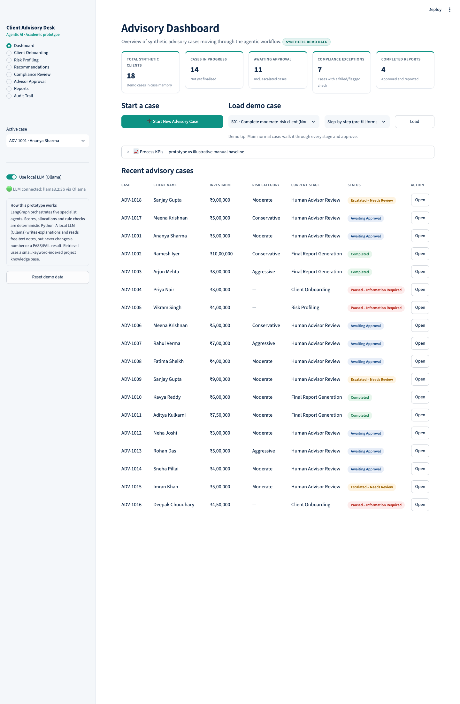

Figure 3. Summary cards, start-a-case and load-demo-case controls, and the case table with stage and status.

### 5.2 Onboarding and exception at intake

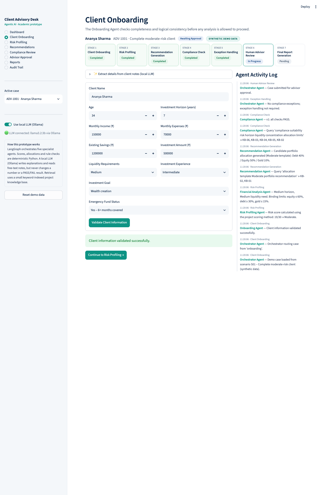

Figure 4. Onboarding. The advisor can paste free-text notes; the Onboarding Agent's LLM fills empty fields, and Python rules validate them.

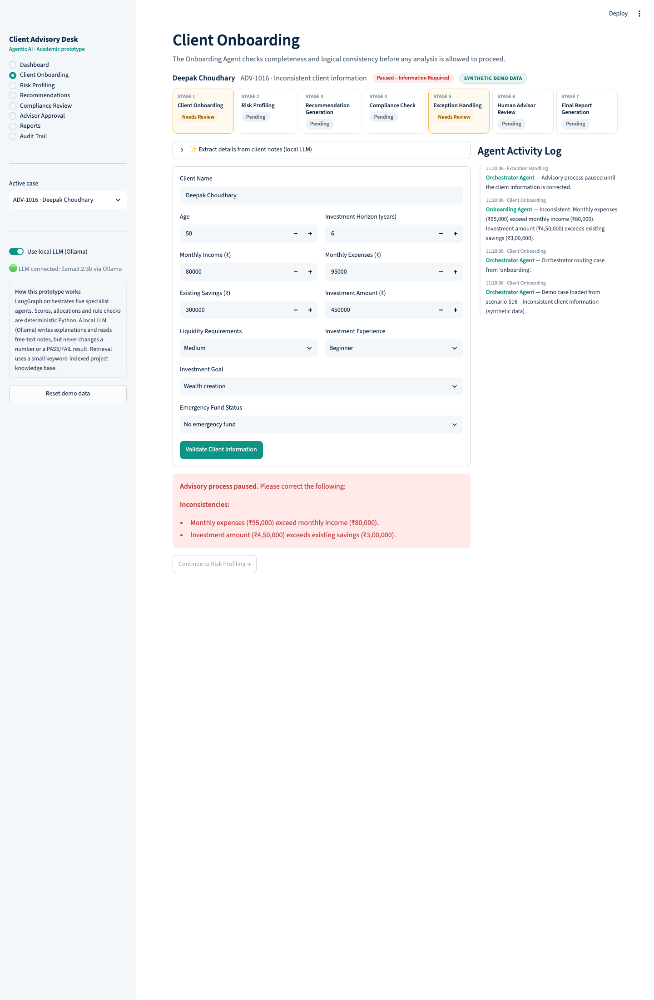

Figure 5. Exception S16. Expenses exceed income and the investment exceeds savings, so the agent pauses the workflow and names each problem.

### 5.3 Risk profiling

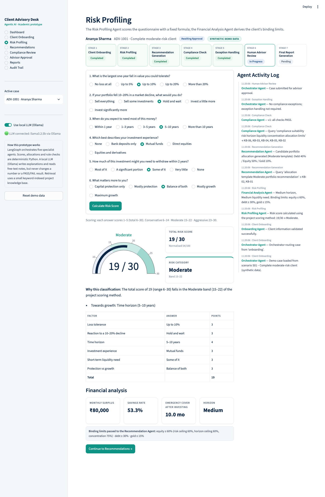

Figure 6. Score gauge, explanation, score breakdown, financial analysis and the binding limits passed to the Recommendation Agent.

### 5.4 Recommendation with re-planning

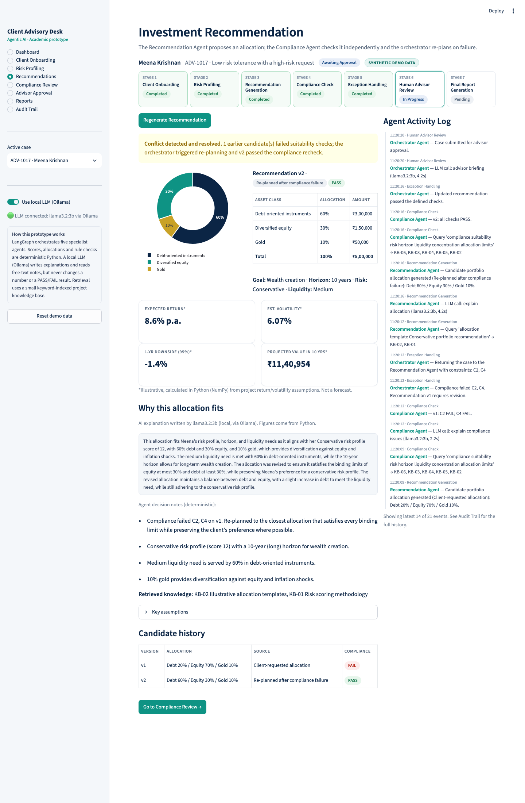

Figure 7. Exception S06. The client asked for 70% equity with a Conservative profile. Compliance failed v1, the orchestrator re-planned, and v2 (30% equity) passed.

### 5.5 Compliance review and escalation

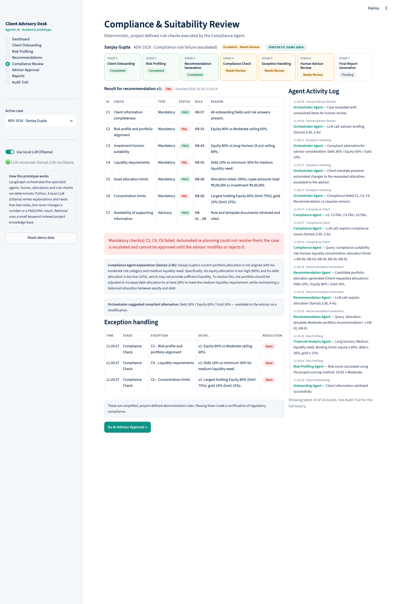

Figure 8. Exception S09. The client's locked mandate (80% equity) fails C2, C4 and C6. The case is escalated with an LLM explanation and a compliant alternative.

### 5.6 Human advisor approval

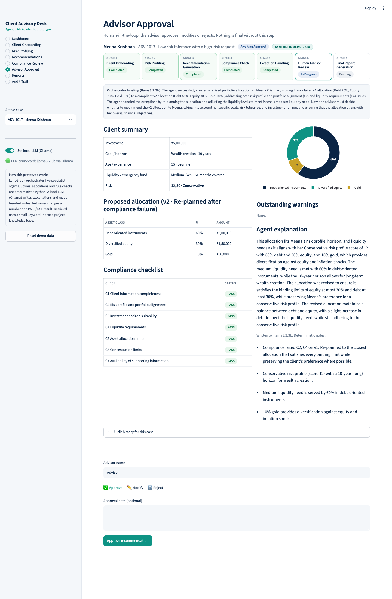

Figure 9. Approval screen with the orchestrator's LLM briefing, client summary, allocation, checklist and the Approve / Modify / Reject controls.

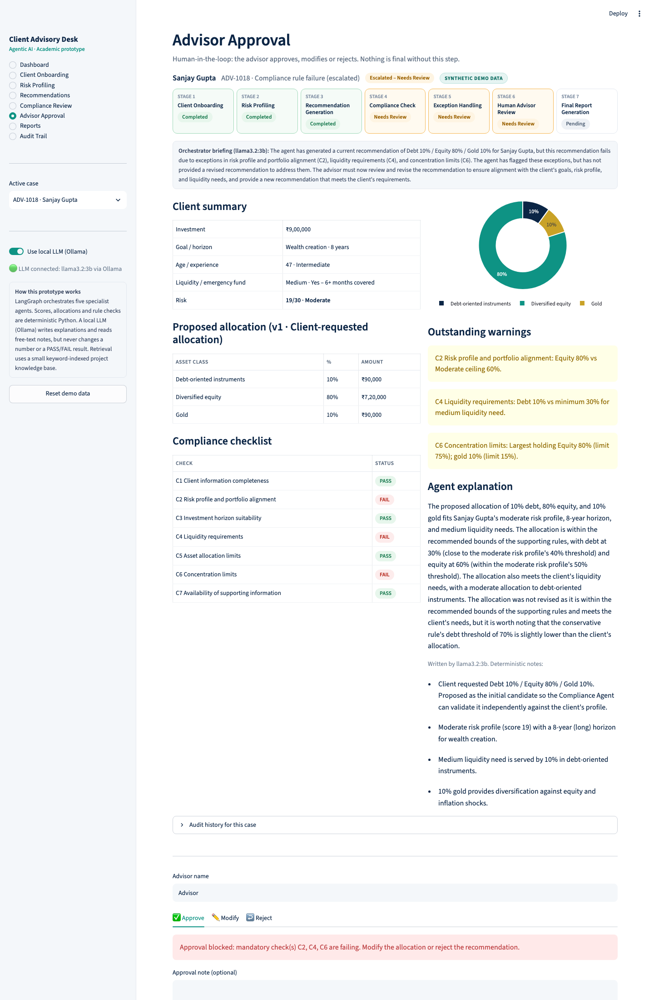

Figure 10. For the escalated case, Approve is disabled until the advisor modifies or rejects the recommendation.

### 5.7 Final report and audit trail

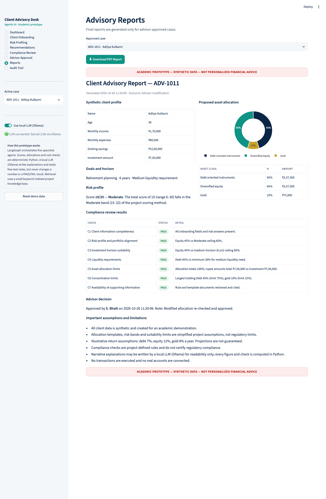

Figure 11. Report for an approved case, with a PDF download. Every report carries the academic-prototype disclaimer.

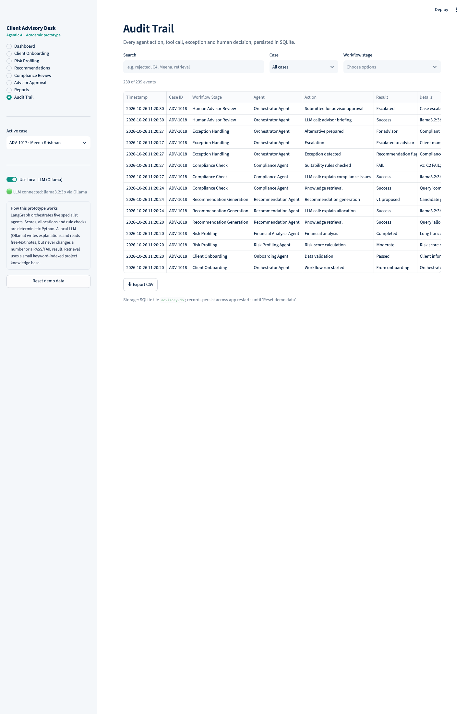

Figure 12. Searchable audit trail of every agent action, tool call, LLM call, exception and human decision.

## 6. Agent decision trace

The audit log of scenario S06 shows the agents detecting a risk mismatch and fixing it without human help, in 14 seconds including four LLM calls. The client had a Conservative profile (score 12/30) but requested 70% equity. Excerpt, in time order (LLM and retrieval events shortened):

| Time | Agent | Action | Result | Detail |
| --- | --- | --- | --- | --- |
| 11:20:06 | Onboarding Agent | Data validation | Passed | Client information validated |
| 11:20:06 | Risk Profiling Agent | Risk-score calculation | Conservative | 12/30 by the project formula |
| 11:20:06 | Financial Analysis Agent | Financial analysis | Completed | Binding limits: equity ≤ 30%, debt ≥ 30%, gold ≤ 15% |
| 11:20:09 | Recommendation Agent | Recommendation generation | v1 proposed | Client-requested Debt 20 / Equity 70 / Gold 10; explained by LLM (3.4 s) |
| 11:20:12 | Compliance Agent | Suitability rules checked | FAIL | C2 and C4 fail; failure explained by LLM (2.2 s) |
| 11:20:12 | Orchestrator Agent | Exception detected | Flagged | Recommendation v1 requires revision |
| 11:20:12 | Orchestrator Agent | Re-plan | Attempt 1 of 2 | Constraints C2, C4 sent back to the Recommendation Agent |
| 11:20:16 | Recommendation Agent | Recommendation generation | v2 proposed | Debt 60 / Equity 30 / Gold 10, nearest compliant allocation |
| 11:20:16 | Compliance Agent | Suitability rules checked | PASS | All seven checks pass |
| 11:20:16 | Orchestrator Agent | Exception resolved | Resolved | Updated recommendation passed the defined checks |
| 11:20:20 | Orchestrator Agent | Submitted for approval | Awaiting approval | Advisor briefing written by LLM (4.2 s) |

The trace shows the four behaviours the guidelines ask for: tool use (retrieval, calculations, LLM), memory (the re-plan uses v1's result), decision-making (re-plan rather than escalate), and a hand-off to human approval.

## 7. Testing and evaluation

All 16 scenarios reached their expected outcome and all 45 automated tests passed on the final build. Tests run with the LLM switched off, so results are deterministic and do not depend on the model.

### 7.1 Scenario results

| ID | Scenario | Type | Final status | Compliance per candidate | Final allocation (D/E/G %) |
| --- | --- | --- | --- | --- | --- |
| S01 | Complete moderate-risk client | Normal | Awaiting approval | PASS | 40 / 50 / 10 |
| S02 | Conservative client | Normal | Completed | PASS | 70 / 20 / 10 |
| S03 | Aggressive client | Normal | Completed | PASS | 20 / 70 / 10 |
| S04 | Missing investment horizon | Exception | Paused | — | — |
| S05 | Incomplete risk questionnaire | Exception | Paused | — | — |
| S06 | Low tolerance, high-risk request | Exception | Awaiting approval | FAIL → PASS | 60 / 30 / 10 |
| S07 | Concentration limit exceeded | Exception | Awaiting approval | FAIL → PASS | 18 / 75 / 7 |
| S08 | High liquidity requirement | Exception | Awaiting approval | FAIL → PASS | 50 / 40 / 10 |
| S09 | Locked mandate, rule failure | Exception | Escalated | FAIL | 10 / 80 / 10 (blocked) |
| S10 | Advisor approval | Normal | Completed | PASS | 40 / 50 / 10 |
| S11 | Advisor modification | Human review | Completed | PASS → PASS | 45 / 45 / 10 |
| S12 | Advisor rejection | Human review | Awaiting approval | PASS → PASS | 50 / 40 / 10 |
| S13 | Horizon changed 12 → 2 years | What-if | Awaiting approval | FAIL → PASS | 60 / 30 / 10 |
| S14 | Risk category changed | What-if | Awaiting approval | PASS | 70 / 20 / 10 |
| S15 | Knowledge source unavailable | Exception | Escalated | NEEDS REVIEW | 40 / 50 / 10 |
| S16 | Inconsistent client information | Exception | Paused | — | — |

### 7.2 Automated tests

The 45 pytest tests check that:

- each scenario reaches its expected status;
- allocations total 100% and rupee amounts reconcile for every scenario;
- risk scores are deterministic;
- re-planning resolves mismatches;
- approval is blocked for failing or unacknowledged cases;
- advisor modifications re-run compliance;
- rejection needs a reason and returns the case to recommendation;
- what-if changes trigger re-planning;
- PDF generation and amount normalisation for LLM extraction work.

### 7.3 KPI evaluation

Baseline values are illustrative assumptions, as allowed by the guidelines; prototype values are measured.

| KPI | Manual baseline (assumed) | Prototype (measured) |
| --- | --- | --- |
| Processing time per case | 90 min | About 10 min: under 1 s automated (10–15 s with LLM) + 10 min assumed review; −89% |
| Missing / inconsistent data | Often found late | Caught at intake in 3 of 3 cases |
| Compliance rework cycle | About 24 h per hand-off | Seconds; 4 of 6 flagged cases auto-resolved, 2 correctly escalated |
| Consistency of rules | Varies by analyst | 100% identical results for identical inputs |
| Arithmetic integrity | Manual errors possible | 100% of recommendations reconcile to the rupee |
| Human approval | Manual sign-off | 100% of reports approved; failing cases cannot be approved |
| Auditability | Notes and spreadsheets | Every action and decision logged per case |

### 7.4 LLM quality check

We tested notes extraction on two sample notes. After adding Python amount conversion and clearer option definitions, 21 of 22 fields were correct. The remaining error: "may need some money early" was read as Low liquidity instead of Medium. This is why extracted values are suggestions that a person reviews. Explanations and briefings stayed consistent with the computed figures in every run we inspected.

## 8. Limitations

- Synthetic data and simplified project rules; this is not regulatory compliance or financial advice.
- KPI baselines and the 10-minute review time are assumptions, not field measurements.
- The 3B local model is small: it can misread vague wording and its explanations are plain rather than polished.
- Retrieval is keyword-based over eight documents, not semantic search over a large corpus.
- No authentication: anyone using the app acts as the advisor.

## 9. Lessons learned

- **Keep the LLM away from decisions.** Deterministic rules made every test repeatable; the LLM added value only where language was needed.
- **Do deterministic work before the LLM.** Converting "16 lakh" to 1,600,000 in Python fixed the model's biggest extraction error.
- **Design for failure.** Template fallbacks meant an LLM or knowledge-base outage never stopped a case, which also made the live demo safe.
- **Escalation needs rules too.** The most useful design decision was defining when the orchestrator must stop re-planning: advisor changes, locked mandates and missing evidence go to a person.

## 10. Future work

1. Replace keyword retrieval with vector search over real product and regulatory documents.
2. Use a larger or enterprise-approved LLM, with an evaluation set for extraction accuracy.
3. Add authentication and separate advisor and compliance-reviewer roles.
4. Measure a real manual baseline in a pilot with one advisory team.
5. Integrate authorised product data and a managed database.

## 11. Conclusion

The prototype shows that a multi-agent system can run the whole advisory process, not just answer questions about it. The orchestrator and five agents handled every normal, exception and what-if scenario as designed. They re-planned when rules allowed and escalated when they did not, and every final decision stayed with a human advisor. Against the assumed baseline, processing time per case fell from 90 to about 10 minutes, with a complete audit trail for every case.

## Appendix: running the prototype

Repository: https://github.com/raghul-t2/AI-Automation. Requirements: Python 3.11+, Ollama and the llama3.2:3b model (about 2 GB).

```
git clone https://github.com/raghul-t2/AI-Automation.git
cd AI-Automation
python3 -m venv .venv && source .venv/bin/activate
pip install -r requirements.txt
ollama pull llama3.2:3b
streamlit run app.py
```

The app opens at http://localhost:8501 with 16 preloaded cases. Without Ollama it still runs, using template explanations. Run the tests with `pytest -q` and regenerate the results table with `python evaluate.py`.
